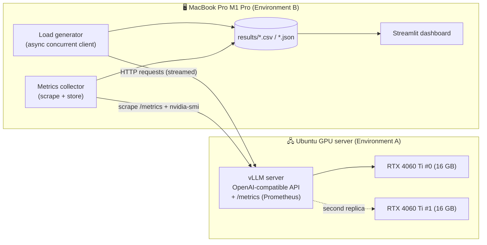

# Proposed Architecture

> Proposal for review. Nothing here is built or installed yet (Stage 0 is audit-only).

## Two-machine split

The Mac drives load and visualizes; the Ubuntu box does all inference. The network hop is
measured explicitly (client-side TTFT vs server-side) so it's never hidden.

## Components

| Component | Choice | Why |
| --------- | ------ | --- |
| Inference server | **vLLM** (OpenAI-compatible) | Continuous batching + PagedAttention KV cache + built-in Prometheus `/metrics` — exactly the behaviors this project studies. llama.cpp server is kept as an optional baseline. |
| Load generator | **Python `asyncio` + `httpx`** | Fire N concurrent streaming requests; measure TTFT and inter-token latency per request. Reuses the Mac's existing env. |
| Concurrency generator | Config-driven sweep (1, 2, 4, 8, 16, …) | Produce the latency-vs-throughput curve experimentally. |
| Metrics collection | vLLM `/metrics` (throughput, running/waiting, KV-cache usage) + `nvidia-smi` (GPU util, VRAM) | Server-truth + hardware-truth, timestamped. |
| Results storage | `results/*.csv` + run manifest `*.json` | Plain, diff-able, reproducible; no DB needed. |
| Dashboard | **Streamlit** (reused from Project 2) | Reads the CSVs; plots latency/throughput/concurrency/memory. |

## Why vLLM (vs llama.cpp server here)

llama.cpp (Project 1) is excellent for **edge/CPU/Metal single-stream** inference. This project
is about **multi-user serving**, where the wins come from **continuous batching** and
**PagedAttention** — vLLM's core features — plus a metrics endpoint purpose-built for this.
We may still run a llama.cpp baseline for contrast, but vLLM is the subject under study.

## Single-GPU vs multi-GPU plan

- **Default:** one 8B model on **one** RTX 4060 Ti (quantized, so KV cache has room). Clean,
  no PCIe cross-talk — the right place to study batching and KV cache.
- **Scaling study:** a **second replica** on GPU #1 (data parallel) to show throughput scaling
  under concurrency. Tensor-parallel across the two cards is possible but PCIe-bound (no NVLink),
  so it's a documented experiment, not the default.

## Reproducibility

Every run writes a manifest: model, quantization, vLLM flags, `max_model_len`, concurrency,
prompt/gen token counts, GPU(s), driver/CUDA, and a git SHA — so any number on the dashboard
traces back to an exact configuration.
